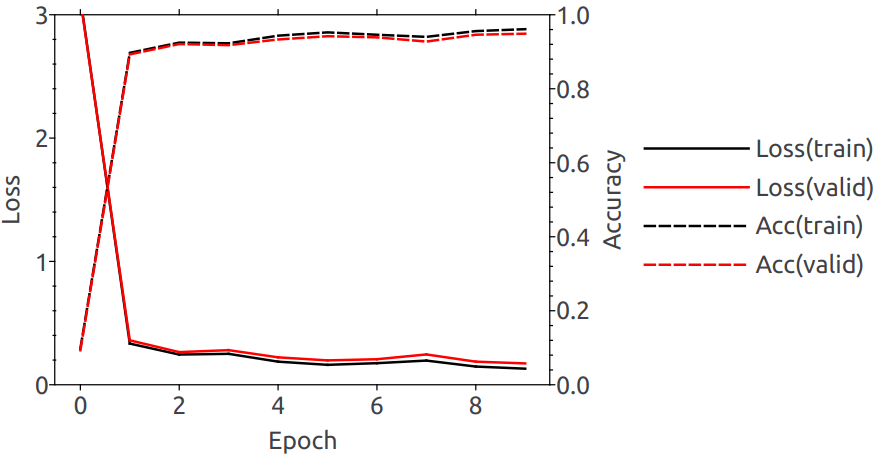

<!--
This file is part of Physica.

SPDX-FileCopyrightText: 2024-2026 Weibo He
SPDX-License-Identifier: GFDL-1.3-no-invariants-or-later
-->

# Notes on MNIST

Example-Mnist is used to demonstrate how to build a neural network using coroutine-based automatic differentiation.

**Fig. 1** A single hidden layer neural network with 32 neurons was trained for handwritten digit recognition. The validation set accuracy reached 96%, which is close to existing results $^{[1]}$.

## Reference

[1] 2-layer NN; <http://yann.lecun.com/exdb/mnist/>
