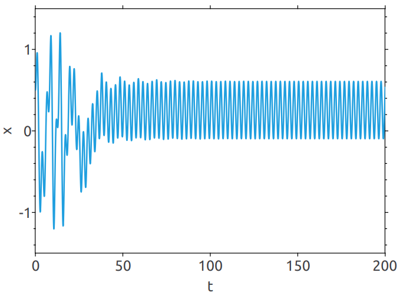
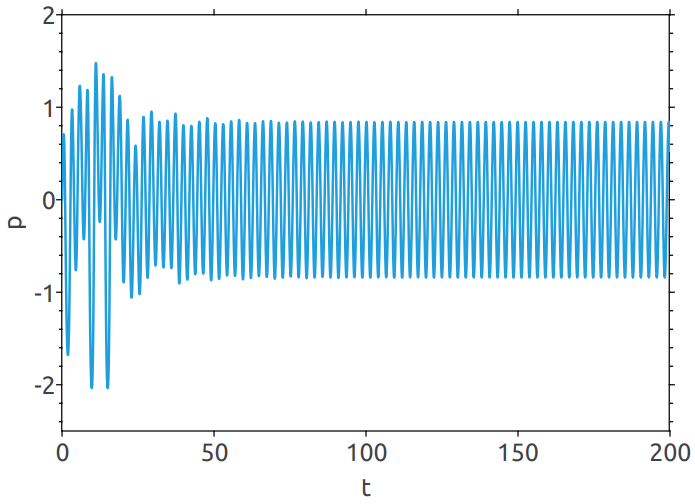
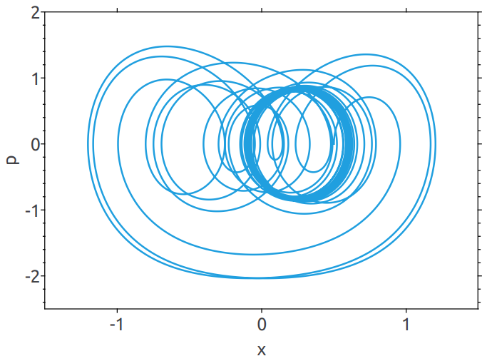

<!--
This file is part of Physica.

SPDX-FileCopyrightText: 2024-2026 Weibo He
SPDX-License-Identifier: GFDL-1.3-no-invariants-or-later
-->

# DuffingOscillator

The example demonstrates how to use *Physica*'s ODESolver to solve ordinary dfferential equations

**Figure 1** Duffing oscillator position x as a function of time

**Figure 2** Duffing oscillator momentum p as a function of time

**Figure 3** Phase portrait (x-p) of the Duffing oscillator

## Reference

[1] J. H. Thijssen. Computational Physics[M]. London: Cambridge University Press, 2013:11-12
