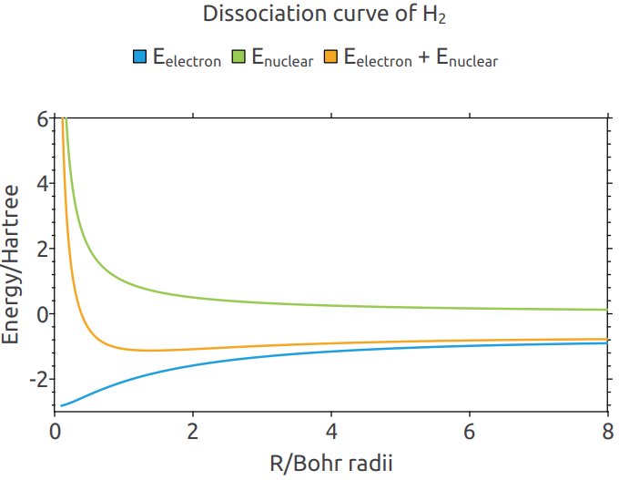

<!--
This file is part of Physica.

SPDX-FileCopyrightText: 2024-2026 Weibo He
SPDX-License-Identifier: GFDL-1.3-no-invariants-or-later
-->

# HF

This example demonstrates how to use the Hartree-Fock approximation to compute isolated molecular systems, using the dissociation curve of the hydrogen molecule as an example.

**Figure 1** Dissociation curve of the hydrogen molecule. The energy minimum is $E_{min} = -1.126545057 \; \mathrm{Hartree}$ at $r_0 = 1.38375 \; \mathrm{Bohr}$, in good agreement with Ref. [1] which reports $r_0 = 1.38 \; \mathrm{Bohr}$.

## Reference

[1] Larsen A, Poulsen R S. Applied Hartree-Fock methods. <https://projekter.aau.dk/projekter/files/213481562/report.pdf>
