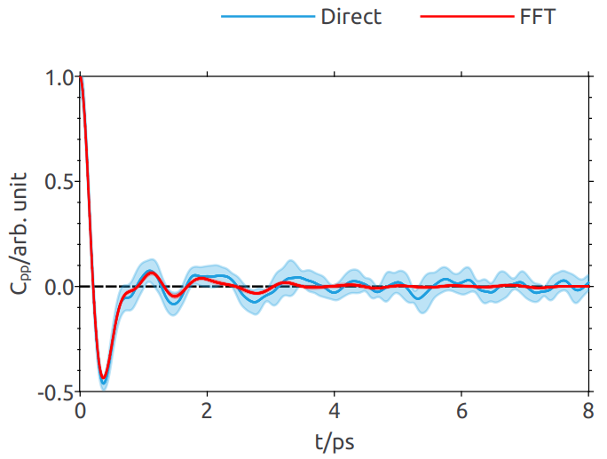

<!--
This file is part of Physica.

SPDX-FileCopyrightText: 2024-2026 Weibo He
SPDX-License-Identifier: GFDL-1.3-no-invariants-or-later
-->

# Correlation

**Figure 1** Normalized momentum autocorrelation function of Kr crystal$^{[1]}$ at 186K, computed using both the direct method and the FFT method. Within statistical error, the two methods give consistent results. The implemented direct method only considers correlations from $t = 0$ forward, resulting in larger uncertainty compared to the FFT method.

## Reference

[1] Phys. Rev. 188, 1407 (1969); <https://doi.org/10.1103/PhysRev.188.1407>
