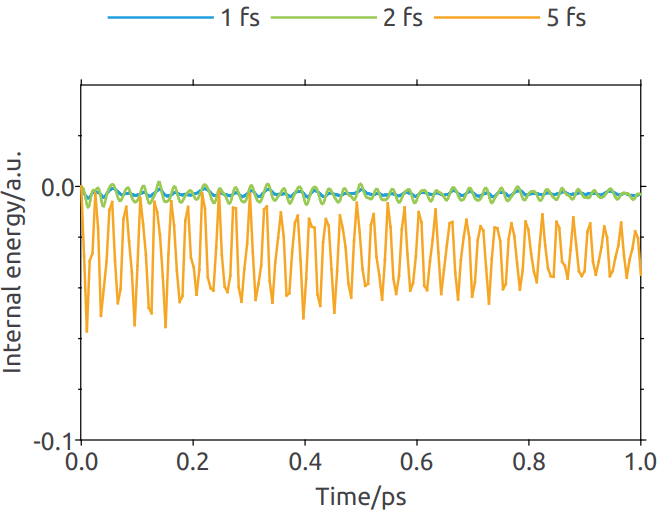

<!--
This file is part of Physica.

SPDX-FileCopyrightText: 2024 Weibo He
SPDX-License-Identifier: GFDL-1.3-no-invariants-or-later
-->

# TestNVE

This example demonstrates how to use the testNVE function to test the convergence of the integration timestep.

**Figure 1** Using silica as an example: system internal energy as a function of time for different timesteps. Since the NVE ensemble is used, the system energy should be conserved. The 5 fs timestep curve shows energy oscillations due to an excessively large step and is unsuitable for practical simulations. Depending on accuracy requirements, choosing 1 fs or 2 fs is more appropriate.
